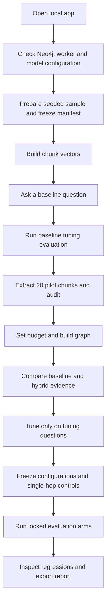
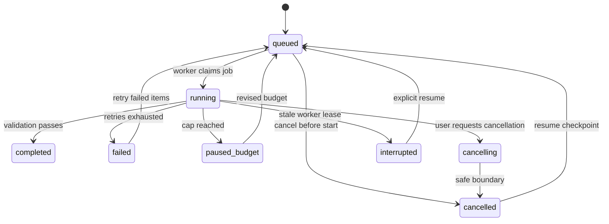

# App flow

UI navigation follows UI-UX.md revision 2: first-run users start on Overview; returning users resume their last page/run once vectors are ready. Citation clicks open an inline evidence inspector without discarding compared answers. Full Evidence review restores the prior question/run on return. Example selection edits the draft only; Run comparison explicitly submits it. Opening an evaluation row reads saved results and never triggers a new LLM request.

## First successful experiment

The graph can fail to improve results. The terminal outcome is an auditable report, not necessarily a positive delta.

## Question request

1. Select active ready snapshot, strategies and question.
2. Validate question length and configuration; persist a request/job id.
3. Load immutable strategy settings; retrieve vector candidates.
4. For graph modes, link question entities and expand bounded graph frontiers.
5. Merge candidates, optionally rerank, pack context and eligible triples.
6. Generate structured answer; validate citations and persist timings/usage.
7. Display answer cards. Citation selection opens Evidence for the same run id.

If graph linking returns no seeds, record vector fallback. If answer generation fails, persist failed status rather than a fabricated answer. If evidence is insufficient, persist an abstention as a valid response.

## Index job state machine

Resume reuses validated cache entries and records a new job attempt. Ready snapshot activation occurs only after index validation. Existing ready snapshots remain selectable while another build is incomplete. Cancellation stops new calls; it cannot reverse completed calls or their charges.

## Evaluation flow

Choose frozen question set and compatible arms → persist run manifest → enqueue each arm → persist per-question results → compute metrics over the fixed denominator → compute paired comparisons → export immutable report.

Report prerequisites: same question ids, corpus, answer model and context budget; any mismatches disable direct paired comparison and explain why. A later prompt or resolver change requires a new versioned experiment. Do not overwrite old scores.

## Recovery

- Neo4j unavailable: keep queued work and show connectivity error; retry once service returns.
- Model download unavailable: setup fails clearly; no extraction calls begin.
- Malformed extraction: bounded retry, then quarantine with validation reason.
- Browser closes: worker continues; reopening shows persisted job state.
- Worker stops: heartbeat expires; mark interrupted and offer checkpoint resume.
- Budget reached: stop scheduling calls, preserve completed artifacts and show revised estimate.
