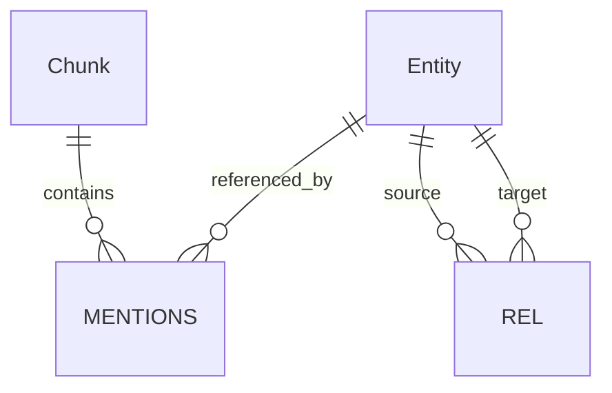

# Backend schema and service contracts

## Storage boundaries

Neo4j owns retrievable chunks, canonical entities and evidence-backed relations. SQLite owns local job/run state. Immutable JSONL files own raw corpus, extraction and evaluation artifacts. Manifests connect these stores by ids and hashes. No database contains API secrets.

## Neo4j graph



`MENTIONS` and `REL` above represent graph relationships, not separate relational tables.

| Record | Properties |
|---|---|
| Chunk | id, corpus_id, paragraph_id, title, text, sentence_ids: list[int], sentence_texts: list[str], embedding: list[float], embedding_model, content_hash, chunker_version |
| Entity | id, corpus_id, canonical_name, normalized_name, type, aliases: list[str], resolver_version |
| MENTIONS: Chunk → Entity | mention_ids: list[str], sentence_ids: list[int], surface_forms: list[str] |
| REL: Entity → Entity | id, corpus_id, type, evidence_chunk_ids: list[str], extraction_version |

Graph properties remain primitives or homogeneous lists; nested evidence objects live in the evidence JSONL artifact. Each relation id resolves to all evidence records with sentence ids and quoted spans. Do not infer positional correspondence between independent graph list properties.

Constraints: unique Chunk.id and Entity.id; indexed Entity.normalized_name and Entity.type; application validation enforces all required properties, enums and evidence references. Relation id deduplication uses idempotent `MERGE` under a single writer, avoiding assumptions about edition-specific relationship constraints.

Vector index: Chunk.embedding, cosine, dimension obtained from pinned model. Wait for ONLINE before retrieval. Refuse model/dimension/fingerprint mismatch. Graph endpoints and every evidence chunk must belong to the same corpus; application checks enforce this.

IDs: corpus id hashes source checksum + selected ids + corpus preprocessing version. Paragraph id hashes title + original sentence sequence. Chunk id also includes corpus id and sentence span. Entity id is a persisted canonical cluster id scoped to the snapshot. Relation id hashes corpus id + canonical source id + relation type + canonical target id. A resolver change rebuilds the snapshot; it does not silently remap historical run evidence.

## Extraction contract (Pydantic models to implement)

EntityType enum: PERSON, ORGANIZATION, LOCATION, WORK, EVENT, CONCEPT.

RelationType enum: DIRECTED_BY, WRITTEN_BY, BORN_IN, DIED_IN, LOCATED_IN, PART_OF, MEMBER_OF, FOUNDED_BY, SPOUSE_OF, PARENT_OF, CREATED_BY, PARTICIPATED_IN.

Pilot may show gaps; changes require a new schema version before full evaluation. Do not silently use arbitrary relation names. Literal/date comparisons may rely on chunk text in MVP; this graph is not a complete fact database.

```json
{
  "schema_version": "1",
  "chunk_id": "chunk-example",
  "entities": [
    {"local_id": "e1", "name": "Example Film", "type": "WORK", "sentence_ids": [0]},
    {"local_id": "e2", "name": "Alex Example", "type": "PERSON", "sentence_ids": [0]}
  ],
  "relations": [
    {"source": "e1", "type": "DIRECTED_BY", "target": "e2",
     "evidence": [{"sentence_id": 0, "quote": "Example Film was directed by Alex Example."}]}
  ]
}
```

Illustrative fixture, not a real extracted claim. Validate extra fields forbidden, nonempty bounded names, unique local ids, endpoint existence, sentence ownership and verbatim spans. Empty entity/relation lists are valid. Initial caps: 40 entities and 60 relations per chunk; exceeding caps produces a visible validation failure. Relation directions are canonical (WORK DIRECTED_BY PERSON, PERSON BORN_IN LOCATION); keep a compatibility map for all relation types and reject mismatches.

## SQLite records

| Table | Primary key | Essential columns / references |
|---|---|---|
| datasets | id | source, checksum, seed, sample_count, manifest_path, created_at |
| index_snapshots | id | dataset_id FK, fingerprint UNIQUE, status, vector_status, graph_status, coverage_json, artifact_path |
| jobs | id | kind, snapshot_id FK nullable, config_json, state, progress_done, progress_total, cancel_requested, created_at |
| job_attempts | id | job_id FK, attempt_number, started_at, heartbeat_at, ended_at, error_code, error_message |
| runs | id | snapshot_id FK, job_id FK, strategy, split, config_hash, config_json, question_set_hash, state, artifact_path |
| predictions | (run_id, question_id) | run_id FK, answer, status, citations_json, retrieval_json, latency_ms, usage_json, failure_code |
| usage_events | id | job_attempt_id FK, run_id FK nullable, stage, request_id, model, input_tokens, output_tokens, estimated_cost, pricing_version, status |
| comparisons | id | run_ids_json, compatibility_hash, metrics_json, intervals_json, report_path |

Enable foreign keys, transaction boundaries and WAL for local read/write overlap. UTC timestamps everywhere. Monetary cost is nullable when unknown, with currency and pricing timestamp; never default unknown usage to zero. Unique job kind+snapshot+config key for active jobs prevents duplicate submissions. Schema version tracked in a migrations table.

## Artifact records

- `manifest.json`: dataset source/checksum, selected question ids, splits, software/model revisions, all configs, timestamps, artifact hashes.
- `paragraphs.jsonl` / `chunks.jsonl`: original text and exact sentence mapping.
- `questions.jsonl`: ids/questions/types/splits; `labels.jsonl`: answers and title/sentence supporting facts, evaluation-only.
- `extractions.jsonl`: validated outputs, source hash and schema/prompt/model versions; failures stored separately.
- `resolution.jsonl`: mention id, canonical entity id, candidate scores, decision reason and resolver version.
- `relation_evidence.jsonl`: relation id, chunk id, sentence ids, quoted spans and extraction provenance.
- `results.jsonl`: per-question answers, retrieved ids, packed sentence ids, triples, flags, usage and timings.

Write temporary files then atomically rename; hash completed artifacts. SQLite marks completion only after durable artifacts and validations finish.

## Service contracts

| Service | Input | Output |
|---|---|---|
| prepare_dataset | SampleConfig | DatasetManifest |
| enqueue_index | snapshot_id, stage, BudgetConfig, idempotency_key | JobRef |
| get_job | job_id | JobStatus with progress/error/retryability |
| cancel_job | job_id | cancellation-requested status |
| resolve_entities | validated chunk extractions, ResolverConfig | canonical mapping and audit records |
| retrieve | question, snapshot_id, strategy, RetrievalConfig | ranked chunks, origins, paths, triples, diagnostics |
| answer | question, packed evidence, AnswerConfig | short answer, status, citations, usage |
| enqueue_evaluation | snapshot_id, question_set_id, strategies, frozen config | JobRef and RunRefs |
| compare_runs | run_ids | compatibility result, aggregate metrics, paired deltas |
| export_report | comparison_id, format | local artifact path |

Answer citation: chunk_id + original sentence_ids. RetrievalResult stores ranks and strategy-specific scores separately, total candidates before caps, cap hits and fallback reason. ContextResult stores exactly what the answer model received so recall is scored on actual context.

Errors: INVALID_INPUT, DEPENDENCY_UNAVAILABLE, INDEX_NOT_READY, CONFIG_MISMATCH, BUDGET_EXCEEDED, PROVIDER_ERROR, VALIDATION_FAILED, CANCELLED. Errors include sanitized message, retryable boolean and job/run id. No HTTP status codes are needed until a separate API is added.
