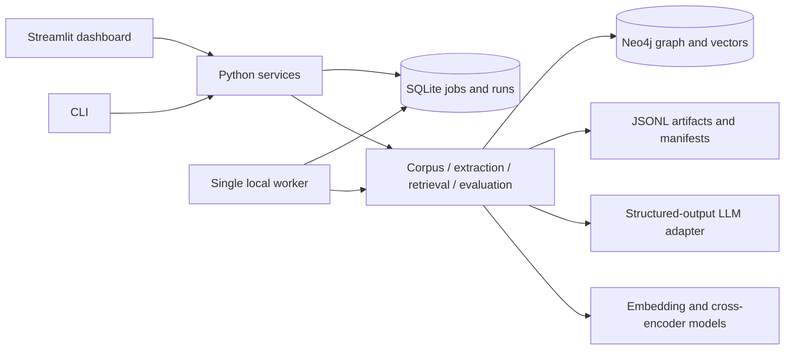

# Technical requirements — GraphRAG Lab

## Architecture



No HTTP API in MVP. Dashboard and CLI share typed Python services. The worker executes long jobs independently of Streamlit reruns. Only one worker and one active index build are supported initially. Answers are persisted as runs and may execute through the same job queue.

## Stack and layout

Python, Pydantic, Neo4j Python driver, sentence-transformers, Streamlit, SQLite standard library, pytest and Ruff. Proposed model defaults: `sentence-transformers/all-MiniLM-L6-v2` for embeddings and `cross-encoder/ms-marco-MiniLM-L-6-v2` for reranking. Verify licenses, input lengths and revisions during setup; pin dependencies and Docker digest after a smoke test. Embedding dimension is read from the loaded model and validated against the index, never silently assumed.

```text
src/graphrag_lab/
  config.py, models.py, cli.py
  corpus.py, chunking.py, provenance.py
  embeddings.py, neo4j_store.py, llm.py
  extraction.py, resolution.py, graph_index.py
  retrieval.py, linking.py, hybrid.py, answering.py
  scoring.py, evaluation.py, reports.py
  jobs.py, worker.py, run_store.py
  decomposition.py                 # optional
app/
  app.py, pages/, components/
tests/
  unit/, integration/, e2e/, fixtures/
configs/, data/, artifacts/, docs/, tasks/
```

Proposed commands to implement, not existing commands:

```sh
docker compose up -d neo4j
python -m pip install -e ".[dev]"
python -m graphrag_lab.cli prepare --config configs/default.yaml
python -m graphrag_lab.cli index --stage vector --config configs/default.yaml
python -m graphrag_lab.cli evaluate --strategy vector --split tuning
python -m graphrag_lab.cli index --stage graph --config configs/default.yaml
python -m graphrag_lab.cli evaluate --strategy hybrid_rerank --split tuning
python -m graphrag_lab.cli worker
python -m streamlit run app/app.py
python -m pytest tests/unit -q
python -m pytest tests/integration -q
python -m ruff check .
python -m compileall src app
```

Code conventions: typed service boundaries, snake_case functions, explicit error types, small functions and Pydantic validation. Example interface style: `def retrieve(request: RetrievalRequest) -> RetrievalResult: ...`. Repository adapters own Cypher; UI owns presentation; scorers never invoke LLMs.

## corpus

Sample 150 questions from the labeled HotpotQA dev distractor release with seed 42, stratified by bridge/comparison type where possible. Store the exact selected ids and source checksum. Partition into 30 tuning and 120 locked evaluation examples with type counts preserved as closely as possible.

Pool every provided context paragraph from selected questions, including distractors. Deduplicate on normalized title plus exact sentence-sequence content hash; preserve variants and original aliases rather than silently replacing text. A question-to-paragraph map resolves supporting titles to the correct paragraph variant.

One paragraph per chunk by default; long paragraphs split at sentence boundaries with one sentence overlap. Initial target 180 embedding-tokenizer tokens, adjusted to keep title plus content within the pinned embedding model's input limit. Reject silent truncation. Store actual token counts and original sentence indices, including overlap. Chunk ids hash corpus id, paragraph id, span and chunker version.

Gold answers/supporting facts live separately from retriever input. Graph extraction sees corpus text only, never question labels. A shared unlabeled corpus may contain paragraphs from locked questions: this is retrieval corpus construction, disclosed explicitly; tuning uses no locked answers or evidence labels.

## vector-qa

Embed title plus chunk text once, normalize embeddings consistently, validate finite values and expected dimension. Index in Neo4j with cosine similarity. Use one active corpus/index namespace; do not rely on post-filtering ANN results to isolate mixed corpora. MVP uses a dedicated database volume per experiment workspace and refuses mismatched manifests.

Initial retrieval: 30 vector candidates, final top 8 chunks, maximum 3,000 answer-context tokens including triples. Budget packing uses the answer model tokenizer or a documented conservative estimator. Reranker input lengths are also checked; split long pairs or explicitly record truncation before using them.

Answer output: short answer, supported/insufficient_evidence status and sentence-grounded citations. Supply only retrieved evidence and task instructions; treat corpus text as data. Reject citations outside supplied context. Citation validity is not proof of entailment; manually audit a sample and report that limitation. Empty evidence returns an explicit abstention.

## graph-index

Extract per chunk into fixed entity/relation enums described in BACKEND-SCHEMA.md. Every entity uses a chunk-local identifier. Every relation refers to those identifiers and cites at least one sentence id with a verbatim evidence span. Validate span presence, sentence ownership and relation endpoints. Syntactically valid but false claims remain possible; audit pilot output before scaling.

Use temperature zero where supported, cache by chunk hash + model revision + prompt/schema version, allow at most two retries after the initial attempt, back off transient failures, and quarantine exhausted errors. Usage for failed/retried calls still counts toward spend.

Resolution stages: Unicode normalization, whitespace/punctuation normalization and case folding for candidate generation; exact same-type alias candidates; lexical near-match candidates; embedding/context similarity to rank those candidates. Names alone do not auto-merge ambiguous common names. Initials such as J. Smith require corroborating context and no conflicting full name. Do not use union-find transitive closure blindly; each cluster addition must remain compatible with the canonical entity and existing members. Preserve all original mentions and the decision log. Uncertain entities stay separate.

Pilot audit: review 20 chunks and a mixture of candidate merges/non-merges. Tune thresholds on those examples, freeze resolver version, record false merges and missed merges. This is a quality sample, not a formal large-scale precision claim.

Load directed `REL` edges with semantic type as a property and evidence chunk ids. Store `MENTIONS` links independently. A relation can have several evidence chunks; repeated loads union evidence deterministically. Commit in small idempotent batches.

Graph-ready requires no failed/unprocessed extraction chunks. An operator may explicitly activate a partial snapshot, but all results then carry a partial-index flag and coverage statistics. Never silently label a partial graph complete.

## hybrid-qa

1. Retrieve vector candidates.
2. Extract up to 5 question entity mentions using the same fixed type vocabulary; link exact aliases first, then lexical/context candidates. Query entities never create graph nodes.
3. Expand linked seeds through `REL` for at most 2 hops. Traverse either direction for recall while retaining semantic direction in displayed triples.
4. Fetch relation evidence chunks and chunks mentioning reached entities. Prefer direct edge evidence; incidental mentions have lower pre-rerank priority.
5. Bound traversal before expansion: at most 25 eligible edges per node per hop, 100 visited entities, 40 graph chunks and a 2-second graph-query timeout as initial tunable budgets. Parameterize values where supported; whitelist query templates for hop count. Record every cap hit.
6. Merge by chunk id; keep vector/graph/both origin, ranks, path ids and distance. Do not add incomparable raw scores. Deterministic reciprocal-rank fusion selects at most 60 candidates before reranking.
7. Cross-encoder ranks merged candidates against the question. Final 8 chunks packed under the same total context budget as the vector arm.
8. Optional triples view includes at most 12 evidence-backed triples whose evidence chunks survive context packing. Triple tokens count against the same budget. Do not send paths whose underlying evidence has been dropped.

No linked entity or traversal failure falls back to vector retrieval with a visible flag. Cross-encoder failure uses the deterministic pre-rerank ranking with a degraded flag. Persist such cases; do not silently omit them from evaluation.

The supplied variable-length Cypher is a conceptual starting point. `LIMIT 20` after path enumeration does not bound the traversal work. Implement bounded frontier expansion rather than relying on that final limit as a resource guard.

## evaluation

Arms: A vector; B vector+reranker; C vector+graph+same reranker without triples; D C+triples. B versus C isolates graph candidate expansion; C versus D isolates triple augmentation. A versus D reports the complete package effect. E decomposition is optional.

Hold corpus/index fingerprint, question ids, embedding model, answer model/prompt, final chunk cap and total context budget fixed. Different graph retrieval cost is part of the result. Save candidate counts and tokens; disclose any unavoidable configuration differences.

Use official HotpotQA answer normalization/scoring semantics, including yes/no/noanswer handling. Unit-test against reference fixtures. Report:

- Answer exact match and token F1, macro averaged, 0–100 scale.
- Paragraph recall@k: fraction of gold supporting paragraphs present in retrieval.
- All-support coverage@k: fraction of questions where every gold supporting paragraph is retrieved.
- Sentence-support recall@k: fraction of gold title/sentence pairs whose sentence actually appears in retrieved context, mapped via source provenance. This measures retrieval coverage, not supporting-fact prediction F1.
- Each retrieval metric both before reranking and after final context packing; deduplicate repeated/overlapping evidence.
- Warm latency p50/p95, cold model-load time separately, query tokens/cost, failed/degraded/abstained counts.
- One-time indexing: wall time, unique chunk count, embeddings, extraction calls/tokens, retries, estimated API cost, local hardware and measured compute time. Do not call local compute free; monetary compute cost may remain unpriced.

For paired arm deltas, bootstrap paired question ids with seed 42 and 2,000 replicates for 95% intervals. Report bridge/comparison strata and counts. Shared evidence and small samples limit inference; do not claim population-wide significance.

Create 30 separate single-hop questions manually from one-paragraph facts in the corpus; verify each answer/support mapping without running the compared systems. Freeze the file before evaluating these controls and do not tune on them. Report as an authored control, separately from the 120 multi-hop locked examples. If controls are not completed, the single-hop requirement is incomplete.

Infrastructure failures count as failures in the primary denominator with zero answer score; also provide successful-run-only diagnostics. Retrying a failed run creates a linked attempt and preserves the original result. A final report cannot quietly drop difficult or failed questions.

## decomposition, optional

Planner produces at most two sub-questions, with the second optionally depending on the first answer. Stop when evidence is insufficient; do not use an unsupported intermediate answer as fact. Combine evidence under the same final context budget. Cap total calls, log intermediate retrieval and report extra tokens/latency. Compare on tuning questions; choose before locked evaluation.

## Reliability, security and verification

Persist atomic artifacts and job checkpoints, recover stale worker leases on restart, and honor cancellation between batches/calls. Cancellation cannot undo a provider request already in flight. Before each call reserve worst-case cost under configured max output tokens; reconcile with actual usage. Missing price metadata blocks monetary estimates and requires a call/token cap instead. Never label unknown cost as zero.

Use parameterized Cypher, fixed enums, bounded question lengths and redacted logs. Bind local services to loopback; retain provider keys only in environment. No arbitrary tools or Cypher supplied by the LLM execute.

Unit tests: mapping, deduplication, scoring, schema validation, resolution collisions, rank fusion and budgets. Neo4j integration: constraints, repeat ingestion, vector lookup, bridge retrieval, index isolation and restart. E2E: small fixture corpus through each arm with a deterministic fake LLM, plus a separately marked paid pilot. UI: keyboard flow, source navigation, empty/failure states and exported records.

Always preserve provenance and record versions. Never fabricate metrics, suppress failed cases or commit credentials. Revisit the plan before adding public hosting, uploads or multi-user access.
